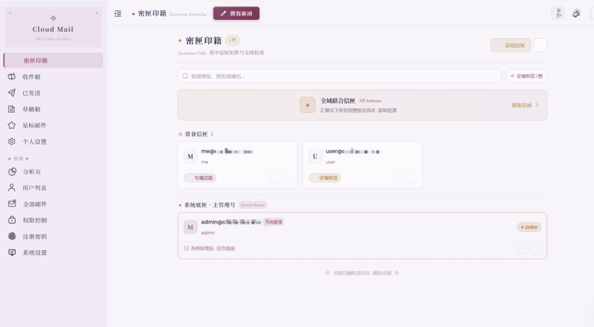
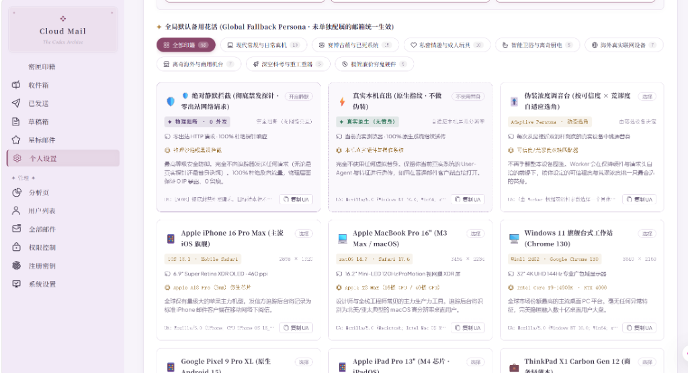

  

    
  

  <h1 align="center">✦ Cloud Mail Codex ✦</h1>
  
Serverless Medieval Codex Aesthetic Mailbox on Cloudflare Workers · Hardened Privacy Shield · Edge Deceptive Telemetry Poisoning

  

    <a href="./README.md">简体中文</a> | <a href="./README-en.md">English</a>
  

---

### ✦ Epigraph

> "Since commercial data harvesting pipelines have already laid their cables to our doorstep, returning empty-handed would lack polite decorum."

This edition is a comprehensive reimagining of Cloud Mail across visual aesthetics, privacy sandboxing, and edge deception.
It brings antique papyrus codex, obsidian stealth, and celadon emerald tactile atmospheres to everyday mail, builds robust defenses against tracker pixels, and feeds verifiable yet whimsical synthetic personas back to telemetry probes.

---

## ✦ Key Capabilities

### 1. Codex Tactile Aesthetics & Adaptive Layouts (Aesthetics & Architecture)
- **Triple Haute Horlogerie & Codex Themes**:
  - **Muted Codex**: Soft muted papyrus tones, deep plum ink, brushed bronze gold, and dusty rose borders.
  - **Obsidian Stealth**: Minimalist matte dark slate, frosted glass cards, and cool titanium accents.
  - **Celadon Emerald**: Translucent pale jade with classical ink accents.
- **Astrolabe Celestial Star Loader**: Pure inline SVG vector clockwork with counter-rotating celestial rings, octagram crest breathing pulse, and a 2px gilded progress bar.
- **Mobile-First Accounts Hub**:
  - Mobile devices enter the Accounts Hub card matrix directly upon cold start.
  - Pinned "All Inboxes" card at the top for unified chronological review.
  - Daily mailboxes and aliases take center stage, while the system master account is sinked to the bottom with muted admin styling.
  - Quick return pill in the inbox header for seamless mailbox switching.
  - Local state persistence across sessions and background wakeups (`cloud_mail_last_account_id`).
- **Typography & Motion**: Harmonious pairing of Huiwen Mincho and Cormorant Garamond Serif Italic, ornate fleurons (✦ / ❖ / ✧), and damped physical micro-interactions.

### 2. Hardened Privacy Shield & Sanitization Sandbox (Security & Privacy Shield)
- **Independent Concurrent Device Sessions**: Simultaneous logins across desktop, mobile, and tablets maintain isolated tokens without session dropping.
- **Deep DOM Sanitizer**: Complete elimination of hazardous tags (`<script>`, `<iframe>`, `<object>`, `<embed>`) and inline event handlers.
- **Remote CSS Fingerprint Blocker**: Defense against remote stylesheet `@import` and custom font probing that leak public IP addresses.
- **Beacon Neutralizer & Link Stripper**:
  - Intercepts 1x1 tracking pixels, hidden zero-dimension web beacons, and telemetry probes.
  - Automatically strips UTM, marketing query strings, and tracking tokens from outbound URLs.
  - Neutralizes mixed `srcset` candidates and isolates local/remote attachments.
- **In-App Privacy Audit Telemetry Console**: Real-time modal displaying blocked trackers and honeypot events.

### 3. Decoy Personas & Adaptive Telemetry Poisoning (Decoy Theater)
- **Tactical Countermeasures Beyond Passive Blocking**:
  - **Silent Block (`silent_block`)**: Complete physical outbound isolation with zero external network requests.
  - **Native Direct Mode**: Pass-through native browser fingerprints when desired.
  - **Edge Telemetry Poisoning (`edge telemetry poisoning`)**: Cloudflare Workers generate genuine HTTP requests on behalf of the user, feeding synthetic device profiles back to tracker endpoints.
- **58+ Whimsical Decoy Device Personas**:
  - **Smart Sanitation & Bizarre Appliances**: Kohler Numi 2.0 Smart Toilet, Tesla Model S Plaid Console, Smart Toaster.
  - **Commercial Kiosks & Aviation**: McDonald's Self-Order Kiosk, Vegas Slot Machine, KTV Terminal, Boeing 787 In-Flight Entertainment (IFE).
  - **Deep Space & Heavy Physics**: James Webb Space Telescope (JWST), Ohio-class Submarine Sonar Terminal, CERN Particle Collider Console.
  - **Cyberpunk Relics & Dead Systems**: Nokia N97, Sony PSP-1000, iPod Classic, Meizu M6 MP3, Palm Pre.
  - **Intimate Hardware**: LELO F1S V2, Satisfyer Pro 2 Gen3, Kiiroo Keon 1/2.
  - **Mainstream Workhorses**: iPhone 16 Pro Max, MacBook Pro M4, Pixel 9 Pro XL, iPad Pro M4, ThinkPad X1 Carbon.
- **Per-Mailbox Binding Matrix**: Assign distinct decoy personas to individual mailboxes.
- **Adaptive Decoy Theater**: Simulates organic human reading duration before dispatching edge responses, disrupting tracking algorithms.

### 4. Serverless Mail Engine (Core Capabilities)
- **Economical Serverless Stack**: Built on Cloudflare Workers, D1 database, KV store, and R2 object storage.
- **Full-Featured Mail Flow**: Powered by Resend for outbound delivery with attachment and inline asset handling.
- **Workers AI Verification Extraction**: Automatically extracts verification codes from incoming messages.
- **Catch-All Routing**: Single mailbox catch-all support with multi-domain bindings.
- **Granular RBAC**: Role-based access control, registration keys, and quota administration.

---

## ✦ Live Demonstration

  
<strong>Accounts Hub (Mailbox Matrix & Catch-All Routing)</strong>

  
    
  
<strong>Decoy Personas & Adaptive Telemetry Poisoning Theater</strong>

  

---

## ✦ Technical Architecture

- **Runtime**: [Cloudflare Workers](https://developers.cloudflare.com/workers/)
- **API Framework**: [Hono](https://hono.dev/)
- **Database & ORM**: [Cloudflare D1](https://developers.cloudflare.com/d1/) with [Drizzle ORM](https://orm.drizzle.team/)
- **State & Caching**: [Cloudflare KV](https://developers.cloudflare.com/kv/)
- **Object Storage**: [Cloudflare R2](https://developers.cloudflare.com/r2/)
- **Frontend Core**: [Vue 3](https://vuejs.org/) + [Vite](https://vitejs.dev/) + [Pinia](https://pinia.vuejs.org/) + [Vue Router](https://router.vuejs.org/)
- **Component System**: [Element Plus](https://element-plus.org/) + [Iconify](https://iconify.design/)
- **Continuous Deployment**: GitHub Actions with Cloudflare Wrangler

---

## ✦ Deployment Guide

Automated deployments trigger via GitHub Actions on every push to the `main` branch.

### 1. Repository Secrets & Variables
Configure the following in GitHub `Settings -> Secrets and variables -> Actions`:
- `CLOUDFLARE_API_TOKEN`: API token with Workers, D1, KV, and R2 permissions
- `CLOUDFLARE_ACCOUNT_ID`: Cloudflare Account Identifier
- `DOMAIN`: JSON array of accepted domains, e.g., `["example.com"]`
- `ADMIN`: Administrator email address, e.g., `admin@example.com`
- `JWT_SECRET`: Signing secret for token verification
- `CUSTOM_DOMAIN` (optional): Custom domain bound to Worker routes

### 2. Run Deployment
Push changes to `main` or trigger the `Deploy cloud-mail to Cloudflare Workers` workflow manually from the Actions tab.

---

## ✦ License

This project is licensed under the [MIT](LICENSE) License.
